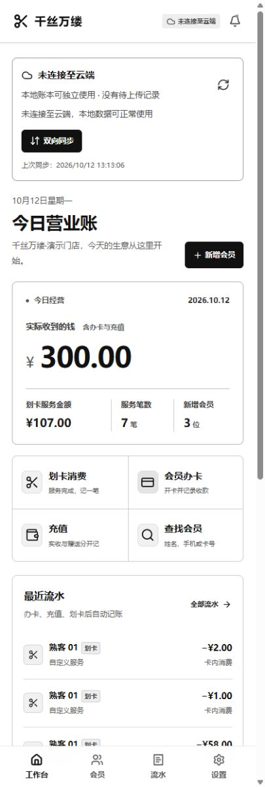
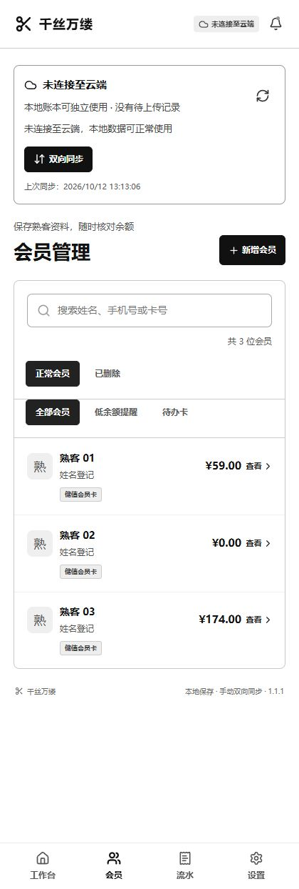
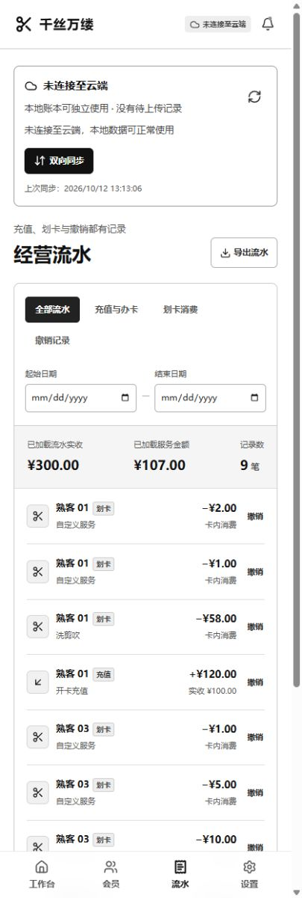
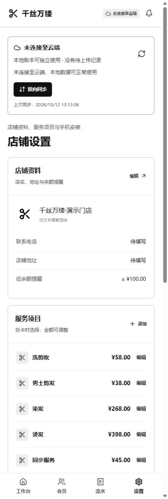
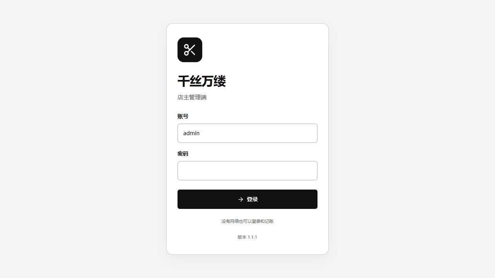

# 千丝万缕

**理发店会员储值与划卡记账，开店时随手记，收工后方便核对。**

千丝万缕是一款面向理发店店主的会员管理应用，把会员登记、办卡充值、服务扣费和经营流水放在一起。顾客充值后，店主在每次理发、洗剪吹、染发或烫发结束时，从会员卡余额中划扣实际消费金额，随时查询剩余余额与历史记录，减少纸本登记和手工算账。

采用简洁的黑白界面，主要提供 Android 应用，也保留浏览器管理入口。当前为单店店主管理端，同一账号管理同一家店。

[应用展示](#应用展示) · [主要功能](#主要功能) · [技术栈](#技术栈) · [系统适配](#系统适配) · [安装与使用](#安装与使用) · [最新迭代](#最新迭代)

## 应用展示

以下为 Android 1.1.1 内置界面的演示截图，使用本机隔离的合成账本，不包含真实会员资料或真实经营数据。当前源码版本为 **1.1.2（versionCode 7）**；截图中的账号仅用于展示，不代表可用的默认账号。点击图片可查看原图。

<table>
  <thead>
    <tr>
      <th align="center">工作台</th>
      <th align="center">会员管理</th>
      <th align="center">经营流水</th>
      <th align="center">店铺设置</th>
    </tr>
  </thead>
  <tbody>
    <tr>
      <td align="center" valign="top"><a href="docs/images/workbench.jpg"></a></td>
      <td align="center" valign="top"><a href="docs/images/members.jpg"></a></td>
      <td align="center" valign="top"><a href="docs/images/ledger.jpg"></a></td>
      <td align="center" valign="top"><a href="docs/images/settings.jpg"></a></td>
    </tr>
    <tr>
      <td align="center">今日经营与快捷记账</td>
      <td align="center">会员档案与卡内余额</td>
      <td align="center">收款、消费与撤销</td>
      <td align="center">店铺资料与服务项目</td>
    </tr>
  </tbody>
</table>

<p align="center"><strong>店主管理登录</strong></p>
<p align="center">
  <a href="docs/images/login.jpg"></a>
</p>

## 主要功能

| 功能 | 可以做什么 |
| --- | --- |
| 会员登记 | 姓名或手机号二选一登记；按姓名、手机号或卡号查找会员。姓名允许重名，非空手机号不能重复。 |
| 储值会员卡 | 一位会员一张卡，查询总余额、本金与赠送余额；已有卡直接充值或消费。不提供次卡。 |
| 办卡与充值 | 分别记录实际收款和赠送金额，合计计入卡内余额，实收金额单独统计。 |
| 划卡消费 | 选择会员及服务项目，核对实际扣款金额后提交；余额不足时拒绝扣费。 |
| 经营概览 | 查看今日实收、划卡服务金额、服务笔数、新增会员和近期流水，关注低余额会员。 |
| 流水核对 | 按日期及交易类型筛选，导出 CSV；错账可填写原因撤销，保留原记录并生成反向流水。 |
| 会员删除与恢复 | 本金和赠送余额均为零才能删除；已删除会员可恢复，原卡号、资料和历史流水保留。 |
| 店铺设置 | 维护店名、联系方式、地址、服务项目、价格及低余额提醒。 |
| Android 离线记账 | 首次联网登录完成数据准备后，可断网登录、查询和记账，修改先保存到本机加密账本。 |
| 手动双向同步 | 店主点击「双向同步」上传本机修改并下载云端最新账本；同步冲突保留待同步操作，交由店主核对。 |

实收金额和划卡消费金额分别统计，避免把充值收款与后续卡内消费重复计为现金收入。撤销充值属于账务调整，实际退款由店主另行处理。

## 技术栈

| 层级 | 技术 | 用途 |
| --- | --- | --- |
| 界面与业务 | React 19、TypeScript 5.9、Tailwind CSS 4、Lucide React | 共用会员、储值卡、流水和设置界面，适配手机与桌面布局。 |
| Web 应用与构建 | Next.js App Router 结构、Vinext、Vite 8 | 构建浏览器管理端与 Cloudflare Worker；另用 Vite 打包 APK 内置离线页面。 |
| Android 容器 | Java、Android 系统 WebView、Gradle / Android Gradle Plugin | 加载随 APK 打包的页面，通过原生桥接完成网络请求、文件保存和 CSV 导出，无需安装 Chrome。 |
| 本机数据保护 | Android Keystore、AES-GCM、AtomicFile、系统文档目录选择器 | 加密保存完整账本和待同步队列，支持更换存放目录并保留设备内恢复副本。 |
| 云端服务 | Cloudflare Workers、D1（SQLite）、Drizzle ORM | 在店主独立 Cloudflare 账号中运行业务 API、数据库与手动同步接口。 |
| 认证与账务 | 加盐 PBKDF2、服务端 pepper、会话令牌摘要、整数分记账 | 校验店主账号；防止余额透支及同一操作重试重复入账，通过版本检查识别同步冲突。 |
| 验证 | Node.js Test Runner、TypeScript、独立 Android 测试包 | 验证金额计算、数据库约束、会员规则、CSV、同步及原生加密存储。 |

## 系统适配

| 使用方式 | 系统与要求 | 数据与使用方式 |
| --- | --- | --- |
| Android APK | **Android 6.0 及以上（API 23+）**；应用使用系统 WebView，目标 API 为 35。 | 推荐的手机使用方式；支持本机加密账本、离线操作及手动双向同步。最低版本依据构建配置，未逐个 Android 版本做实机验证。 |
| 浏览器管理端 | Windows、macOS、Linux、Android、iOS 上的现代浏览器。 | 通过已部署的服务地址访问，以云端记账为主，需要联网；未逐一验证所有系统与浏览器组合。 |
| iPhone / iPad | 通过浏览器访问。 | 暂无原生 iOS 安装包，不具备 Android 的本机加密账本机制。 |

## 安装与使用

### 安装 Android 应用

1. 向项目维护者获取原签名构建的 `qiansiwanlv.apk`。当前仓库未发布 GitHub Release 安装包；本机构建输出为 `outputs/qiansiwanlv.apk`，该目录不入库。
2. 将 APK 传到手机，按系统提示允许当前安装来源安装应用，安装后打开「千丝万缕」。
3. 更新已有应用时，使用同一包名和原签名直接**覆盖安装**，保留账本与待同步操作；不要先卸载或清除应用数据。
4. 首次打开需联网，使用已配置的店主账号和密码登录，软件自动准备会员、余额、服务项目和流水。无需 ChatGPT 登录；部署与账号配置由维护者完成。

应用包名为 `com.barbershop.app`。当前独立云服务使用 workers.dev 入口，店主按现有方案在手机开启 VPN 连接；不同网络的直连可用性未作保证。

### 日常使用

1. **设置门店**：在「设置」填写店铺资料，配置洗剪吹、染发、烫发等服务项目及价格。
2. **登记会员**：选择姓名或手机号登记，保存后办储值卡，填写实际收款及赠送金额。
3. **充值与划卡**：已有卡直接充值；服务结束后选择会员和服务，核对金额，再确认扣费。
4. **核对账目**：在工作台查看今日经营情况，在「流水」筛选记录；错账填写原因撤销，需要报表时导出 CSV。
5. **同步账本**：Android 修改先保存在本机。联网后点击「双向同步」，建议营业结束时同步一次；连接重试图标只检查网络，联网本身不会自动同步。

多台手机管理同一家店时，各手机需手动同步才能看到彼此的新记录。遇到冲突，先查看核对方案，确认余额和实际业务；失败或冲突会保留本机待同步操作。建议同一笔业务只在一台手机录入。

本机加密文件绑定当前手机与应用密钥，单独复制文件不能在另一台手机解密。换手机、卸载或清除数据前应先完成同步；CSV 为明文报表。完整操作说明见 [离线与双向同步指南](cloud/offline-guide.md)。

### 使用浏览器管理端

打开维护者提供的已部署服务地址，使用店主账号登录即可。Android Chrome 中可选择「添加到主屏幕」作为快捷入口；网页版仍以云端保存为主，不提供 APK 的原生离线存储能力。

### 从源码开发与构建

需要 **Node.js ≥ 22.13.0** 与 npm。在仓库根目录执行：

```sh
npm ci
npm test
npm run typecheck
npm run build
```

本地开发运行 `npm run dev`；构建后的 Worker 预览运行 `npm start`。预览涉及数据库时，需要先初始化本机隔离的 D1 数据库，并按顺序执行尚未应用的 `drizzle/` 迁移；不能连接生产库写入演示数据。预览与生产都需相应的店主账号配置，依赖安装和构建不会自动生成可用账号。

Android 构建另外需要 JDK 21、Gradle 9.1.0、Android SDK Platform 36、Build Tools 36.1.0 及原签名配置，具体命令见 [Android 构建说明](android/README.md)。APK 构建脚本会先构建内置离线界面，再输出安装包。

独立云服务配置、生产部署与加密备份见 [Cloudflare 部署说明](cloud/README.md)。生产数据库升级前先备份，仅执行新增迁移。签名私钥、密码、云端秘密值、真实会员数据和数据库备份不得提交到仓库。

## 最新迭代

| 日期 | 迭代 | 改动与验证状态 |
| --- | --- | --- |
| 2026-10-12 | [README 重写](docs/iterations/2026-10-12-readme-rewrite.md) | 重新整理作品截图、功能介绍、技术栈、系统适配、安装用法和迭代入口；此次仅更新文档。 |
| 2026-10-12 | [Android 1.1.2 · versionCode 7](docs/iterations/2026-10-12-v1.1.2.md) | 云端管理员配置支持自定义用户名，设置中可输入账号与密码重新验证。30 项测试、类型检查、离线构建及原签名 Release 构建通过；手机未连接，未安装验证。新云库已创建，但建表、账号配置和部署切换仍待完成。 |
| 2026-10-12 | [Android 1.1.1 · versionCode 6](docs/iterations/2026-10-12-v1.1.1.md) | 简化登录文案，保留已初始化手机的离线登录；已用原签名覆盖安装。 |
| 2026-10-12 | [Android 1.1.0](docs/iterations/2026-10-12-v1.1.0.md) | 引入 APK 内置页面、本机加密账本和手动双向同步；单元、隔离同步 API、客户端队列及手机独立存储测试通过，已覆盖安装并启动。 |

完整历史见 [CHANGELOG.md](CHANGELOG.md)，逐次需求、改动、测试、数据库迁移、部署与手机安装状态见 [迭代记录目录](docs/iterations/)。
